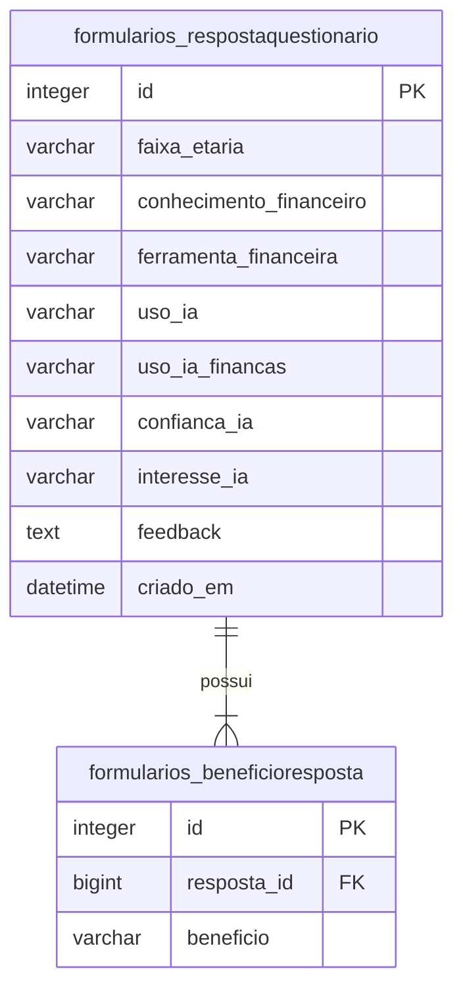

# Banco de dados

O IAEmpreendedora utiliza **SQLite** em todos os ambientes (desenvolvimento local e produção), por meio do Django ORM.

## Configuração

O caminho do arquivo do banco é definido pela variável de ambiente `SQLITE_DB_PATH`.

| Ambiente | `SQLITE_DB_PATH` | Arquivo utilizado |
|---|---|---|
| Desenvolvimento local | não definida | `backend/db.sqlite3` |
| Produção (Render) | **obrigatória**, por exemplo `/var/data/db.sqlite3` | arquivo no disco persistente |

- No Render (detectado pela variável `RENDER=true`, que a plataforma sempre define), a ausência de `SQLITE_DB_PATH` interrompe a inicialização com a mensagem `A variável SQLITE_DB_PATH não foi definida...`. Isso evita que o banco seja criado silenciosamente no armazenamento temporário do serviço.
- Caminhos relativos são resolvidos a partir da pasta `backend/`.
- A pasta indicada precisa existir; o Django cria apenas o arquivo do banco.
- As variáveis podem ser definidas no ambiente ou no arquivo `backend/.env` (veja `backend/.env.example`). Variáveis do ambiente têm prioridade sobre o `.env`.
- `backend/.env`, `db.sqlite3`, os arquivos auxiliares do SQLite (`db.sqlite3-journal`, `db.sqlite3-wal` e `db.sqlite3-shm`) e qualquer outro arquivo `*.sqlite3`, como os backups, são ignorados pelo Git e não devem ser versionados.

## Modelagem

As respostas ficam em duas tabelas, criadas pela migration `formularios/migrations/0001_initial.py`. Os modelos estão em `formularios/models.py`.



Uma resposta tem **um ou mais** benefícios (regra garantida pela aplicação, veja "Restrições de integridade"), e cada benefício pertence a exatamente uma resposta.

Cada questionário enviado gera **uma** linha em `formularios_respostaquestionario` e **uma linha por benefício selecionado** em `formularios_beneficioresposta`. Não são armazenados dados pessoais (nome, e-mail ou IP).

### Dicionário de dados

**`formularios_respostaquestionario`** (modelo `RespostaQuestionario`)

| Coluna | Tipo no SQLite | Nulo | Regra |
|---|---|---|---|
| `id` | `integer`, chave primária | não | gerado automaticamente |
| `faixa_etaria` | `varchar(50)` | não | uma das alternativas de `OPCOES["faixa_etaria"]` |
| `conhecimento_financeiro` | `varchar(50)` | não | uma das alternativas de `OPCOES["conhecimento_financeiro"]` |
| `ferramenta_financeira` | `varchar(50)` | não | uma das alternativas de `OPCOES["ferramenta_financeira"]` |
| `uso_ia` | `varchar(50)` | não | uma das alternativas de `OPCOES["uso_ia"]` |
| `uso_ia_financas` | `varchar(50)` | não | uma das alternativas de `OPCOES["uso_ia_financas"]` |
| `confianca_ia` | `varchar(50)` | não | uma das alternativas de `OPCOES["confianca_ia"]` |
| `interesse_ia` | `varchar(50)` | não | uma das alternativas de `OPCOES["interesse_ia"]` |
| `feedback` | `text` | não | opcional na API; gravado como `""` quando omitido; até 1000 caracteres |
| `criado_em` | `datetime` (UTC), com índice | não | data e hora do envio, preenchida automaticamente |

**`formularios_beneficioresposta`** (modelo `BeneficioResposta`)

| Coluna | Tipo no SQLite | Nulo | Regra |
|---|---|---|---|
| `id` | `integer`, chave primária | não | gerado automaticamente |
| `resposta_id` | `bigint`, chave estrangeira, com índice | não | referencia `formularios_respostaquestionario.id` |
| `beneficio` | `varchar(50)` | não | uma das alternativas de `OPCOES["beneficios_ia"]` |

Os nomes das colunas são os mesmos do contrato da API (`API.md`), e as respostas são gravadas com o texto exato da alternativa escolhida.

### Restrições de integridade

As alternativas válidas vêm do dicionário `OPCOES` de `formularios/validators.py`, que é a fonte única de verdade. Os modelos as utilizam tanto nos `choices` quanto nas restrições do banco. Como o SQLite não aplica o tamanho de `varchar`, as regras abaixo são as que de fato protegem os dados, independentemente de a gravação vir da API, do shell do Django ou de um script. O Django Admin não grava nem exclui dados, pois é somente leitura.

| Restrição | Tabela | Garante |
|---|---|---|
| `formularios_<campo>_valido` (`CHECK ... IN (...)`), uma por campo | respostas | só alternativas válidas, com acentos e maiúsculas exatos; texto vazio é recusado |
| `formularios_feedback_tamanho_maximo` (`CHECK LENGTH(feedback) <= 1000`) | respostas | feedback com no máximo 1000 caracteres |
| `formularios_beneficio_valido` (`CHECK ... IN (...)`) | benefícios | só benefícios válidos |
| `formularios_beneficio_unico_por_resposta` (`UNIQUE (resposta_id, beneficio)`) | benefícios | o mesmo benefício não se repete na mesma resposta |
| chave estrangeira `resposta_id` | benefícios | não existe benefício sem resposta |
| `NOT NULL` em todas as colunas | ambas | nenhum campo fica sem valor |

Duas regras ficam **apenas na aplicação**, no validador do R3, porque no banco exigiriam *triggers*: pelo menos um benefício por resposta e a exclusividade da opção `Não vejo benefícios`. A gravação atômica garante que uma resposta nunca fique salva sem os benefícios enviados.

### Gravação atômica

A função `salvar_respostas` (`formularios/persistencia.py`) é chamada pelo endpoint `POST /api/questionario/` somente depois da validação. Ela grava a resposta e os benefícios dentro de `transaction.atomic()`: se qualquer gravação falhar, tudo é desfeito e nenhuma linha fica no banco.

### Exclusão em cascata: Django × SQL

O modelo usa `on_delete=models.CASCADE`, mas **essa cascata é feita pelo Django, não pelo banco**:

- **Pelo Django ORM** (`resposta.delete()`, `QuerySet.delete()`, shell do Django): o Django apaga primeiro os benefícios relacionados e depois a resposta.
- **Por SQL direto** (`DELETE FROM formularios_respostaquestionario ...`): a chave estrangeira criada no banco **não** tem `ON DELETE CASCADE` (a regra é `NO ACTION`). Se a resposta tiver benefícios, o SQLite recusa a exclusão com erro de chave estrangeira. Para excluir por SQL, apague antes as linhas de `formularios_beneficioresposta`.

A verificação de chaves estrangeiras do SQLite é ativada por conexão. O Django a ativa automaticamente, mas ferramentas externas (o programa `sqlite3`, o DB Browser for SQLite etc.) começam com ela desligada. Antes de alterar dados por fora do Django, execute `PRAGMA foreign_keys = ON;`.

### Consulta pelo Django Admin

As respostas podem ser consultadas em `/admin/` por um usuário da equipe (crie um com `python manage.py createsuperuser`). O admin é **somente leitura**: lista as respostas com filtros por alternativa, benefício e data, e mostra o feedback e os benefícios apenas na página de detalhe de cada resposta. Não é possível incluir, alterar nem excluir respostas por ele.

### Como alterar alternativas sem comprometer o histórico

As alternativas válidas ficam gravadas nas restrições do banco. Por isso, **toda mudança em `OPCOES` exige uma nova migration** (`python manage.py makemigrations formularios`), e o teste `test_nao_ha_migrations_pendentes` falha enquanto ela não for criada.

| Mudança | O que fazer |
|---|---|
| **Incluir** uma alternativa | Alterar `OPCOES`, gerar a migration e aplicar. Os dados antigos não são afetados. |
| **Corrigir o texto** de uma alternativa | Seguir o procedimento abaixo. |
| **Remover** uma alternativa | Decidir antes, com a equipe, o destino das respostas antigas. Para convertê-las em outra alternativa, seguir o procedimento abaixo, com o `UPDATE` apontando para a alternativa escolhida. Manter a alternativa válida só para o histórico exigiria separar a lista do formulário da lista do banco, o que é uma mudança de modelagem. |

#### Procedimento para corrigir o texto de uma alternativa

Exemplo: trocar `Talvez` por `Talvez futuramente` em `interesse_ia`. Há duas armadilhas:

- **Atualizar os dados antes** não funciona: a restrição antiga só aceita `Talvez`, então o `UPDATE` para o texto novo é recusado (`CHECK constraint failed`).
- **Aplicar a nova restrição antes** também não funciona: ao recriar a tabela, o SQLite copia as linhas antigas com `Talvez`, que violam a nova regra, e a migration falha.

A sequência correta, dentro de **uma única migration**, é:

1. Alterar o texto em `OPCOES` (`validators.py`) e executar `python manage.py makemigrations formularios -n renomeia_talvez`. O Django gera, nesta ordem: `RemoveConstraint` (remove a restrição antiga), `AlterField` (atualiza os `choices`) e `AddConstraint` (cria a restrição nova).
2. Editar a migration gerada e inserir um `RunSQL` **entre o `AlterField` e o `AddConstraint`**, de modo que os dados sejam convertidos quando nenhuma restrição está ativa:

   ```python
   migrations.RunSQL(
       sql=(
           "UPDATE formularios_respostaquestionario "
           "SET interesse_ia = 'Talvez futuramente' "
           "WHERE interesse_ia = 'Talvez'"
       ),
       reverse_sql=(
           "UPDATE formularios_respostaquestionario "
           "SET interesse_ia = 'Talvez' "
           "WHERE interesse_ia = 'Talvez futuramente'"
       ),
   ),
   ```

   Para benefícios, a tabela é `formularios_beneficioresposta` e a coluna é `beneficio`. Se o texto novo já existir na mesma resposta, o `UPDATE` violaria `formularios_beneficio_unico_por_resposta`; nesse caso, apague antes a linha duplicada.
3. Testar em uma cópia do banco e só então executar `python manage.py migrate`. A migration é atômica: se qualquer passo falhar, nada é alterado. O `reverse_sql` permite desfazê-la com `python manage.py migrate formularios <migration anterior>`.

Esse procedimento foi validado em uma cópia isolada do banco: o `UPDATE` com a restrição antiga foi recusado, a migration sem o `RunSQL` falhou, e a migration com o `RunSQL` foi aplicada e revertida com sucesso.

Essas mudanças afetam o R3 (formulário e validação), o R4 (banco) e o R5 (dashboard), e devem ser combinadas entre os três. Ao alterar alternativas, atualize também `API.md` e os testes.

## Orientações para o R5 (dashboard)

Esta seção mostra como consultar os dados armazenados para montar os indicadores e gráficos do dashboard. Os endpoints, os gráficos e a integração com o React são responsabilidade do R5; aqui estão a estrutura dos dados, as regras de cálculo e exemplos de consultas já validados.

As consultas são **somente de leitura**. O dashboard nunca deve gravar, alterar ou excluir respostas.

### Onde está cada indicador

| # | Indicador | Origem | Tipo de pergunta |
|---|---|---|---|
| 1 | Total de questionários respondidos | número de linhas de `formularios_respostaquestionario` | — |
| 2 | Faixa etária | coluna `faixa_etaria` | escolha única |
| 3 | Nível de conhecimento financeiro | coluna `conhecimento_financeiro` | escolha única |
| 4 | Ferramenta financeira utilizada | coluna `ferramenta_financeira` | escolha única |
| 5 | Frequência de utilização de IA | coluna `uso_ia` | escolha única |
| 6 | Experiência com IA em atividades financeiras | coluna `uso_ia_financas` | escolha única |
| 7 | Benefícios percebidos | tabela `formularios_beneficioresposta`, coluna `beneficio` | **múltipla escolha** |
| 8 | Confiança nas recomendações financeiras de IA | coluna `confianca_ia` | escolha única |
| 9 | Interesse em utilizar IA | coluna `interesse_ia` | escolha única |
| 10 | Quantidade de feedbacks recebidos | coluna `feedback` | texto livre |
| 11 | Evolução temporal das respostas | coluna `criado_em` | data e hora |

### Regras de cálculo

- **Escolha única (indicadores 2 a 6, 8 e 9):** percentual = quantidade da alternativa ÷ total de questionários do período × 100. A soma fica em 100% (pode dar 99,9% ou 100,1% por causa do arredondamento).
- **Questionários, não pessoas:** o banco não guarda nenhuma identificação individual, então não é possível garantir que cada questionário corresponda a uma pessoa diferente (a mesma pessoa pode enviar mais de um). Todos os números representam **questionários respondidos**. No dashboard, use termos como "questionários" ou "respostas", e não "pessoas" ou "participantes únicos".
- **Múltipla escolha (indicador 7):** para cada benefício, conte os **questionários** que o selecionaram e calcule o percentual sobre o **total de questionários** do período. Como cada questionário pode marcar vários benefícios, **a soma dos percentuais pode passar de 100%**. Todo questionário tem pelo menos um benefício, então a base é a mesma das perguntas de escolha única.
- **Gráficos:** use **barras** (de preferência horizontais, ordenadas) para os benefícios. Não use gráfico de pizza: a pizza pressupõe partes que somam 100%, o que não acontece aqui. Informe a base junto do gráfico (por exemplo, "n = 120 questionários").
- **Feedbacks (indicador 10):** conte apenas os que têm pelo menos um caractere que não seja espaço em branco. Feedback vazio ou formado só por espaços, tabulações, quebras de linha ou outros espaços Unicode não conta. O critério é o mesmo do `str.strip()` do Python (29 caracteres), e o ORM, o SQL e o Django Admin o aplicam de forma idêntica.
- **Todas as alternativas aparecem**, na ordem de `OPCOES`, inclusive as que ainda não receberam respostas (com quantidade 0).
- **Sem questionários no período:** o total é 0, todas as quantidades são 0 e todos os percentuais são 0,0. Nenhuma consulta divide por zero. Recomenda-se que o dashboard mostre uma mensagem como "Ainda não há respostas" em vez de gráficos zerados.
- **Filtro de período:** aplique o mesmo filtro ao numerador e ao denominador. Todas as consultas abaixo já aceitam um período opcional.
- **Sem contagem duplicada:** ao juntar respostas com benefícios, cada questionário aparece uma vez por benefício. Conte questionários com `distinct` (veja "Cuidados" abaixo).
- **Arredondamento:** os exemplos arredondam os percentuais para uma casa decimal. Em empates exatos, o resultado do Python (ORM) e o do SQLite podem diferir em 0,1 ponto: 5 de 16 = 31,25% vira 31,2 no Python, que arredonda empates para o dígito par, e 31,3 no SQLite, que arredonda para cima. Use sempre a mesma fonte (de preferência, o ORM) para todo o dashboard.

### Datas e fuso horário

A coluna `criado_em` é gravada em **UTC**. As datas do dashboard devem ser exibidas no horário de Brasília:

- **Django ORM:** a conversão é automática (`TIME_ZONE = "America/Sao_Paulo"`). Filtros como `criado_em__date__gte` e agrupamentos com `TruncDate` e `TruncMonth` já usam o horário local.
- **SQL:** converta com `date(criado_em, '-3 hours')`. O horário de Brasília está fixo em UTC−3 desde o fim do horário de verão, em 2019; se ele voltar a existir, essa conversão precisará ser revista.

Nos exemplos, o período é informado por duas datas **inclusivas** no horário local: `inicio` e `fim`, no formato `AAAA-MM-DD`. Sem datas, a consulta considera todo o período.

### Consultas com Django ORM (recomendado)

O ORM é o caminho recomendado para um endpoint Django: ele lê as alternativas direto de `OPCOES`, então acompanha automaticamente qualquer mudança nas alternativas.

```python
from datetime import date
from typing import Any

from django.db.models import Count, QuerySet
from django.db.models.functions import TruncDate, TruncMonth

from formularios.models import BeneficioResposta, RespostaQuestionario
from formularios.validators import OPCOES


def filtrar_periodo(
    inicio: date | None = None,
    fim: date | None = None,
) -> QuerySet[RespostaQuestionario]:
    """Questionários enviados entre as datas (inclusive, horário local)."""
    respostas = RespostaQuestionario.objects.all()
    if inicio:
        respostas = respostas.filter(criado_em__date__gte=inicio)
    if fim:
        respostas = respostas.filter(criado_em__date__lte=fim)
    return respostas


def calcular_percentual(parte: int, total: int) -> float:
    """Percentual com uma casa decimal; 0.0 quando não há questionários."""
    return round(100 * parte / total, 1) if total else 0.0


def distribuir_escolha_unica(
    respostas: QuerySet[RespostaQuestionario],
    campo: str,
) -> list[dict[str, Any]]:
    """Indicadores 2 a 6, 8 e 9: quantidade e percentual por alternativa."""
    total = respostas.count()
    contagens = dict(
        respostas.order_by()
        .values_list(campo)
        .annotate(quantidade=Count("id"))
    )
    return [
        {
            "alternativa": alternativa,
            "quantidade": contagens.get(alternativa, 0),
            "percentual": calcular_percentual(
                contagens.get(alternativa, 0),
                total,
            ),
        }
        for alternativa in OPCOES[campo]
    ]


def distribuir_beneficios(
    respostas: QuerySet[RespostaQuestionario],
) -> list[dict[str, Any]]:
    """Indicador 7: questionários que marcaram cada benefício.

    O percentual usa o total de questionários como base, então a soma
    dos percentuais pode passar de 100%.
    """
    total = respostas.count()
    contagens = dict(
        BeneficioResposta.objects.filter(resposta__in=respostas)
        .order_by()
        .values_list("beneficio")
        .annotate(questionarios=Count("resposta", distinct=True))
    )
    return [
        {
            "alternativa": beneficio,
            "questionarios": contagens.get(beneficio, 0),
            "percentual": calcular_percentual(
                contagens.get(beneficio, 0),
                total,
            ),
        }
        for beneficio in OPCOES["beneficios_ia"]
    ]


def contar_feedbacks(respostas: QuerySet[RespostaQuestionario]) -> int:
    """Indicador 10: feedbacks com algum caractere além de espaços."""
    return respostas.filter(feedback__regex=r"\S").count()


def evoluir_respostas(
    respostas: QuerySet[RespostaQuestionario],
    agrupar_por: type[TruncDate] | type[TruncMonth] = TruncDate,
) -> list[dict[str, Any]]:
    """Indicador 11: questionários por dia (TruncDate) ou mês (TruncMonth).

    Dias ou meses sem respostas não aparecem na lista.
    """
    return list(
        respostas.annotate(periodo=agrupar_por("criado_em"))
        .values("periodo")
        .annotate(quantidade=Count("id"))
        .order_by("periodo")
    )
```

Exemplo de uso, reunindo os 11 indicadores (o formato final é decisão do R5):

```python
respostas = filtrar_periodo()  # todo o período
# respostas = filtrar_periodo(date(2026, 11, 1), date(2026, 11, 30))

indicadores = {
    "total_questionarios": respostas.count(),
    "faixa_etaria": distribuir_escolha_unica(respostas, "faixa_etaria"),
    "conhecimento_financeiro": distribuir_escolha_unica(
        respostas,
        "conhecimento_financeiro",
    ),
    "ferramenta_financeira": distribuir_escolha_unica(
        respostas,
        "ferramenta_financeira",
    ),
    "uso_ia": distribuir_escolha_unica(respostas, "uso_ia"),
    "uso_ia_financas": distribuir_escolha_unica(respostas, "uso_ia_financas"),
    "beneficios_ia": distribuir_beneficios(respostas),
    "confianca_ia": distribuir_escolha_unica(respostas, "confianca_ia"),
    "interesse_ia": distribuir_escolha_unica(respostas, "interesse_ia"),
    "feedbacks": contar_feedbacks(respostas),
    "evolucao_diaria": evoluir_respostas(respostas),
    "evolucao_mensal": evoluir_respostas(respostas, TruncMonth),
}
```

`TruncDate` devolve `date` (por exemplo, `2026-11-01`); `TruncMonth` devolve a data e hora do primeiro dia do mês, no horário local.

### Exemplo de resultado

Resultado real das funções acima com os 30 questionários fictícios usados nos testes (`formularios/test_consultas_r5.py`), que conferem automaticamente que este exemplo continua correto.

Faixa etária (escolha única). A alternativa sem respostas aparece com 0, e os percentuais somam 100%:

```text
[
  {"alternativa": "Menos de 18 anos", "quantidade": 6, "percentual": 20.0},
  {"alternativa": "18 a 24 anos",     "quantidade": 6, "percentual": 20.0},
  {"alternativa": "25 a 34 anos",     "quantidade": 6, "percentual": 20.0},
  {"alternativa": "35 a 44 anos",     "quantidade": 6, "percentual": 20.0},
  {"alternativa": "45 a 59 anos",     "quantidade": 6, "percentual": 20.0},
  {"alternativa": "60 anos ou mais",  "quantidade": 0, "percentual": 0.0}
]
```

Benefícios (múltipla escolha). Os percentuais somam 170%, porque muitos questionários marcaram mais de um benefício:

```text
[
  {"alternativa": "Organização de gastos",         "questionarios": 14, "percentual": 46.7},
  {"alternativa": "Planejamento financeiro",       "questionarios": 9,  "percentual": 30.0},
  {"alternativa": "Identificação de desperdícios", "questionarios": 8,  "percentual": 26.7},
  {"alternativa": "Auxílio na tomada de decisões", "questionarios": 16, "percentual": 53.3},
  {"alternativa": "Educação financeira",           "questionarios": 0,  "percentual": 0.0},
  {"alternativa": "Não vejo benefícios",           "questionarios": 4,  "percentual": 13.3}
]
```

Com o banco vazio, todas as funções devolvem as mesmas listas, com quantidades 0 e percentuais 0.0, e `contar_feedbacks` e `respostas.count()` devolvem 0.

### Consultas em SQL (SQLite)

As consultas em SQL servem para conferências em ferramentas externas, como o programa `sqlite3` ou o DB Browser for SQLite. Elas repetem a lista de alternativas no próprio SQL; **se `OPCOES` mudar, essas listas precisam ser atualizadas à mão**.

Todas usam os parâmetros nomeados `:inicio` e `:fim` (datas `AAAA-MM-DD`, inclusivas, no horário local). O valor `NULL` significa "sem limite" naquela ponta do período.

No módulo `sqlite3` do Python, **os dois parâmetros precisam ser informados sempre**: um parâmetro ausente gera o erro `ProgrammingError: You did not supply a value for binding parameter :inicio`. Para não filtrar, passe `None`. Exemplo, com o banco aberto **somente para leitura**:

```python
import sqlite3

conexao = sqlite3.connect("file:db.sqlite3?mode=ro", uri=True)
linhas = conexao.execute(
    consulta_sql,
    {"inicio": "2026-11-01", "fim": "2026-11-30"},  # ou None, sem filtro
).fetchall()
```

Em outras ferramentas, a forma de informar parâmetros varia; consulte a documentação de cada uma ou substitua `:inicio` e `:fim` por datas entre aspas (`'2026-11-01'`) ou por `NULL`.

```sql
-- 1. Total de questionários respondidos
WITH respostas AS (
    SELECT *
    FROM formularios_respostaquestionario
    WHERE (:inicio IS NULL OR date(criado_em, '-3 hours') >= :inicio)
      AND (:fim IS NULL OR date(criado_em, '-3 hours') <= :fim)
)
SELECT COUNT(*) AS total_questionarios
FROM respostas;
```

Nas perguntas de escolha única, a tabela `alternativas` garante que todas as opções apareçam, inclusive as sem respostas. O filtro de período fica na tabela `respostas`, antes do `LEFT JOIN`; se fosse colocado em um `WHERE` depois do `LEFT JOIN`, as alternativas sem respostas desapareceriam.

```sql
-- 2. Distribuição por faixa etária
WITH respostas AS (
    SELECT *
    FROM formularios_respostaquestionario
    WHERE (:inicio IS NULL OR date(criado_em, '-3 hours') >= :inicio)
      AND (:fim IS NULL OR date(criado_em, '-3 hours') <= :fim)
),
total AS (SELECT COUNT(*) AS n FROM respostas),
alternativas(ordem, alternativa) AS (
    VALUES (1, 'Menos de 18 anos'), (2, '18 a 24 anos'),
           (3, '25 a 34 anos'), (4, '35 a 44 anos'),
           (5, '45 a 59 anos'), (6, '60 anos ou mais')
)
SELECT
    a.alternativa,
    COUNT(r.id) AS quantidade,
    COALESCE(ROUND(100.0 * COUNT(r.id) / NULLIF(t.n, 0), 1), 0.0)
        AS percentual
FROM alternativas AS a
CROSS JOIN total AS t
LEFT JOIN respostas AS r ON r.faixa_etaria = a.alternativa
GROUP BY a.ordem, a.alternativa, t.n
ORDER BY a.ordem;
```

<details>
<summary>Consultas SQL dos demais campos de escolha única (indicadores 3 a 6, 8 e 9)</summary>

São iguais à consulta da faixa etária; mudam apenas a lista de alternativas e a coluna do `LEFT JOIN`.

```sql
-- 3. Distribuição por nível de conhecimento financeiro
WITH respostas AS (
    SELECT *
    FROM formularios_respostaquestionario
    WHERE (:inicio IS NULL OR date(criado_em, '-3 hours') >= :inicio)
      AND (:fim IS NULL OR date(criado_em, '-3 hours') <= :fim)
),
total AS (SELECT COUNT(*) AS n FROM respostas),
alternativas(ordem, alternativa) AS (
    VALUES (1, 'Muito baixo'), (2, 'Baixo'), (3, 'Moderado'),
           (4, 'Alto'), (5, 'Muito alto')
)
SELECT
    a.alternativa,
    COUNT(r.id) AS quantidade,
    COALESCE(ROUND(100.0 * COUNT(r.id) / NULLIF(t.n, 0), 1), 0.0)
        AS percentual
FROM alternativas AS a
CROSS JOIN total AS t
LEFT JOIN respostas AS r ON r.conhecimento_financeiro = a.alternativa
GROUP BY a.ordem, a.alternativa, t.n
ORDER BY a.ordem;
```

```sql
-- 4. Distribuição por ferramenta financeira utilizada
WITH respostas AS (
    SELECT *
    FROM formularios_respostaquestionario
    WHERE (:inicio IS NULL OR date(criado_em, '-3 hours') >= :inicio)
      AND (:fim IS NULL OR date(criado_em, '-3 hours') <= :fim)
),
total AS (SELECT COUNT(*) AS n FROM respostas),
alternativas(ordem, alternativa) AS (
    VALUES (1, 'Aplicativos financeiros'), (2, 'Planilhas'),
           (3, 'Anotações ou caderno'),
           (4, 'Não utilizo nenhuma ferramenta')
)
SELECT
    a.alternativa,
    COUNT(r.id) AS quantidade,
    COALESCE(ROUND(100.0 * COUNT(r.id) / NULLIF(t.n, 0), 1), 0.0)
        AS percentual
FROM alternativas AS a
CROSS JOIN total AS t
LEFT JOIN respostas AS r ON r.ferramenta_financeira = a.alternativa
GROUP BY a.ordem, a.alternativa, t.n
ORDER BY a.ordem;
```

```sql
-- 5. Frequência de utilização de IA
WITH respostas AS (
    SELECT *
    FROM formularios_respostaquestionario
    WHERE (:inicio IS NULL OR date(criado_em, '-3 hours') >= :inicio)
      AND (:fim IS NULL OR date(criado_em, '-3 hours') <= :fim)
),
total AS (SELECT COUNT(*) AS n FROM respostas),
alternativas(ordem, alternativa) AS (
    VALUES (1, 'Frequentemente'), (2, 'Algumas vezes'),
           (3, 'Já testei, mas quase não utilizo'),
           (4, 'Nunca utilizei')
)
SELECT
    a.alternativa,
    COUNT(r.id) AS quantidade,
    COALESCE(ROUND(100.0 * COUNT(r.id) / NULLIF(t.n, 0), 1), 0.0)
        AS percentual
FROM alternativas AS a
CROSS JOIN total AS t
LEFT JOIN respostas AS r ON r.uso_ia = a.alternativa
GROUP BY a.ordem, a.alternativa, t.n
ORDER BY a.ordem;
```

```sql
-- 6. Experiência com IA em atividades financeiras
WITH respostas AS (
    SELECT *
    FROM formularios_respostaquestionario
    WHERE (:inicio IS NULL OR date(criado_em, '-3 hours') >= :inicio)
      AND (:fim IS NULL OR date(criado_em, '-3 hours') <= :fim)
),
total AS (SELECT COUNT(*) AS n FROM respostas),
alternativas(ordem, alternativa) AS (
    VALUES (1, 'Organizar gastos'), (2, 'Planejamento financeiro'),
           (3, 'Tirar dúvidas financeiras'), (4, 'Outras atividades'),
           (5, 'Nunca utilizei')
)
SELECT
    a.alternativa,
    COUNT(r.id) AS quantidade,
    COALESCE(ROUND(100.0 * COUNT(r.id) / NULLIF(t.n, 0), 1), 0.0)
        AS percentual
FROM alternativas AS a
CROSS JOIN total AS t
LEFT JOIN respostas AS r ON r.uso_ia_financas = a.alternativa
GROUP BY a.ordem, a.alternativa, t.n
ORDER BY a.ordem;
```

```sql
-- 8. Nível de confiança nas recomendações financeiras de IA
WITH respostas AS (
    SELECT *
    FROM formularios_respostaquestionario
    WHERE (:inicio IS NULL OR date(criado_em, '-3 hours') >= :inicio)
      AND (:fim IS NULL OR date(criado_em, '-3 hours') <= :fim)
),
total AS (SELECT COUNT(*) AS n FROM respostas),
alternativas(ordem, alternativa) AS (
    VALUES (1, 'Nenhuma confiança'), (2, 'Pouca confiança'),
           (3, 'Confiança moderada'), (4, 'Muita confiança'),
           (5, 'Confio totalmente')
)
SELECT
    a.alternativa,
    COUNT(r.id) AS quantidade,
    COALESCE(ROUND(100.0 * COUNT(r.id) / NULLIF(t.n, 0), 1), 0.0)
        AS percentual
FROM alternativas AS a
CROSS JOIN total AS t
LEFT JOIN respostas AS r ON r.confianca_ia = a.alternativa
GROUP BY a.ordem, a.alternativa, t.n
ORDER BY a.ordem;
```

```sql
-- 9. Interesse em utilizar IA
WITH respostas AS (
    SELECT *
    FROM formularios_respostaquestionario
    WHERE (:inicio IS NULL OR date(criado_em, '-3 hours') >= :inicio)
      AND (:fim IS NULL OR date(criado_em, '-3 hours') <= :fim)
),
total AS (SELECT COUNT(*) AS n FROM respostas),
alternativas(ordem, alternativa) AS (
    VALUES (1, 'Sim'), (2, 'Talvez'), (3, 'Não')
)
SELECT
    a.alternativa,
    COUNT(r.id) AS quantidade,
    COALESCE(ROUND(100.0 * COUNT(r.id) / NULLIF(t.n, 0), 1), 0.0)
        AS percentual
FROM alternativas AS a
CROSS JOIN total AS t
LEFT JOIN respostas AS r ON r.interesse_ia = a.alternativa
GROUP BY a.ordem, a.alternativa, t.n
ORDER BY a.ordem;
```

</details>

Nos benefícios, a contagem usa `COUNT(DISTINCT resposta_id)`, ou seja, conta questionários, e o percentual usa o total de questionários do período como base.

```sql
-- 7. Distribuição dos benefícios percebidos
WITH respostas AS (
    SELECT *
    FROM formularios_respostaquestionario
    WHERE (:inicio IS NULL OR date(criado_em, '-3 hours') >= :inicio)
      AND (:fim IS NULL OR date(criado_em, '-3 hours') <= :fim)
),
total AS (SELECT COUNT(*) AS n FROM respostas),
selecoes AS (
    SELECT b.resposta_id, b.beneficio
    FROM formularios_beneficioresposta AS b
    JOIN respostas AS r ON r.id = b.resposta_id
),
alternativas(ordem, alternativa) AS (
    VALUES (1, 'Organização de gastos'), (2, 'Planejamento financeiro'),
           (3, 'Identificação de desperdícios'),
           (4, 'Auxílio na tomada de decisões'),
           (5, 'Educação financeira'), (6, 'Não vejo benefícios')
)
SELECT
    a.alternativa,
    COUNT(DISTINCT s.resposta_id) AS questionarios,
    COALESCE(
        ROUND(100.0 * COUNT(DISTINCT s.resposta_id) / NULLIF(t.n, 0), 1),
        0.0
    ) AS percentual
FROM alternativas AS a
CROSS JOIN total AS t
LEFT JOIN selecoes AS s ON s.beneficio = a.alternativa
GROUP BY a.ordem, a.alternativa, t.n
ORDER BY a.ordem;
```

No feedback, o `char(...)` lista os 29 caracteres que o Python considera espaço em branco: espaço, tabulação, quebras de linha, espaço não separável e outros espaços Unicode. É o mesmo critério do `\S` usado no ORM e do `strip()` usado no Django Admin. Se a lista for alterada, os três deixam de coincidir.

```sql
-- 10. Quantidade de feedbacks recebidos
WITH respostas AS (
    SELECT *
    FROM formularios_respostaquestionario
    WHERE (:inicio IS NULL OR date(criado_em, '-3 hours') >= :inicio)
      AND (:fim IS NULL OR date(criado_em, '-3 hours') <= :fim)
)
SELECT COUNT(*) AS feedbacks
FROM respostas
WHERE TRIM(
    feedback,
    char(9, 10, 11, 12, 13, 28, 29, 30, 31, 32, 133, 160, 5760,
         8192, 8193, 8194, 8195, 8196, 8197, 8198, 8199, 8200, 8201, 8202,
         8232, 8233, 8239, 8287, 12288)
) <> '';
```

```sql
-- 11a. Evolução temporal das respostas (por dia)
WITH respostas AS (
    SELECT *
    FROM formularios_respostaquestionario
    WHERE (:inicio IS NULL OR date(criado_em, '-3 hours') >= :inicio)
      AND (:fim IS NULL OR date(criado_em, '-3 hours') <= :fim)
)
SELECT date(criado_em, '-3 hours') AS dia, COUNT(*) AS quantidade
FROM respostas
GROUP BY dia
ORDER BY dia;
```

```sql
-- 11b. Evolução temporal das respostas (por mês)
WITH respostas AS (
    SELECT *
    FROM formularios_respostaquestionario
    WHERE (:inicio IS NULL OR date(criado_em, '-3 hours') >= :inicio)
      AND (:fim IS NULL OR date(criado_em, '-3 hours') <= :fim)
)
SELECT strftime('%Y-%m', criado_em, '-3 hours') AS mes, COUNT(*) AS quantidade
FROM respostas
GROUP BY mes
ORDER BY mes;
```

### Cuidados

- **Contagem duplicada:** filtrar questionários por benefício cria uma linha para cada benefício encontrado. Para contar questionários, use `distinct`:

  ```python
  beneficios = ["Organização de gastos", "Planejamento financeiro"]

  # Errado: um questionário que marcou os dois benefícios conta duas vezes.
  errado = respostas.filter(beneficios__beneficio__in=beneficios).count()

  # Certo: cada questionário conta uma vez.
  certo = (
      respostas.filter(beneficios__beneficio__in=beneficios)
      .distinct()
      .count()
  )
  ```

- **Dias sem respostas** não aparecem na evolução temporal. Em gráficos de linha, o R5 deve completar esses dias com 0.
- **Privacidade dos feedbacks:** o texto é livre e pode conter dados pessoais escritos por quem respondeu. O dashboard público deve exibir apenas a **quantidade** de feedbacks. Exibir textos exige revisão prévia e deve ser combinado com a equipe.

## Produção no Render

O deploy não faz parte do R4. Esta seção separa o que **já está pronto no código** do que **cabe ao responsável pelo deploy**. Nada disso foi executado no Render: a validação foi feita localmente, simulando o ambiente de produção (`DJANGO_DEBUG=0`, banco em uma pasta separada e reinício do servidor).

### Já implementado

| Item | Onde |
|---|---|
| SQLite como único banco, com o caminho definido por `SQLITE_DB_PATH` | `config/settings.py` |
| Inicialização interrompida no Render quando `SQLITE_DB_PATH` não está definida | `config/settings.py` |
| Configurações lidas de variáveis de ambiente, sem valores de produção no código | `config/settings.py` e `.env.example` |
| Migrations versionadas | `formularios/migrations/` |
| Django Admin somente leitura para consultar as respostas | `formularios/admin.py` |

### A cargo do responsável pelo deploy

1. Criar o Web Service em um **plano pago**, com um **Persistent Disk** (por exemplo, *Mount Path* `/var/data`).
2. Definir *Root Directory* `backend` e *Build Command* `pip install -r requirements.txt`.
3. Escolher e adicionar ao `requirements.txt` um servidor de aplicação (o projeto ainda não tem um) e configurar o *Start Command* (veja abaixo).
4. Definir as variáveis de ambiente de produção.
5. Configurar os arquivos estáticos do Django Admin. Com `DJANGO_DEBUG=0`, o Django não serve esses arquivos: o admin funciona, mas aparece sem estilo.
6. Ajustar as configurações de HTTPS e cookies seguros apontadas por `python manage.py check --deploy`.
7. Resolver, junto com o R3, a pendência de CSRF (veja o `README.md`).
8. Criar o usuário administrativo, validar a persistência e definir a rotina de backup, conforme as seções seguintes.

### Disco persistente e caminho do banco

O sistema de arquivos de um serviço do Render é **temporário**: tudo o que é gravado fora do disco persistente é apagado a cada deploy ou reinício. Como o SQLite é um arquivo, o banco precisa ficar dentro do *Mount Path* do disco.

- **Plano gratuito:** não oferece disco persistente. Nele, **todas as respostas são perdidas** a cada deploy, reinício ou hibernação do serviço. Serve apenas para demonstração, nunca para coletar respostas reais. Para uma demonstração consciente dessa perda, defina explicitamente `SQLITE_DB_PATH=db.sqlite3`.
- **Plano pago:** com o disco montado em `/var/data`, defina `SQLITE_DB_PATH=/var/data/db.sqlite3`.

**Definir `SQLITE_DB_PATH` não garante, sozinho, que os dados sejam preservados.** O Django aceita qualquer pasta existente: um caminho fora do disco (por exemplo, `/tmp/db.sqlite3` ou um *Mount Path* digitado de forma diferente) funciona normalmente até o próximo deploy, quando os dados desaparecem. Depois do primeiro deploy, confirme no *Shell* do serviço:

```bash
python manage.py shell -c "from django.conf import settings; print(settings.DATABASES['default']['NAME'])"
df -h /var/data/db.sqlite3
```

O primeiro comando mostra o arquivo em uso, que deve estar dentro do *Mount Path*. No segundo, a coluna *Mounted on* deve mostrar o *Mount Path* (por exemplo, `/var/data`), e não `/`.

### Migrations e Start Command

O disco persistente só fica disponível quando o serviço é iniciado: ele **não está acessível** no *Build Command* nem no *Pre-Deploy Command*, que rodam em outra máquina. Por isso, as migrations devem ser executadas no *Start Command*, antes do servidor. Se rodarem no build, o Django cria as tabelas em um arquivo temporário, e o banco real no disco fica sem elas.

Exemplo, supondo que o responsável pelo deploy escolha o Gunicorn e o adicione ao `requirements.txt`:

```bash
python manage.py migrate --noinput && gunicorn config.wsgi:application --bind 0.0.0.0:$PORT
```

### Variáveis de ambiente em produção

| Variável | Valor |
|---|---|
| `SQLITE_DB_PATH` | caminho do banco dentro do disco persistente, por exemplo `/var/data/db.sqlite3` |
| `DJANGO_DEBUG` | `0` |
| `DJANGO_SECRET_KEY` | chave longa e aleatória, exclusiva de produção |
| `DJANGO_ALLOWED_HOSTS` | domínio do serviço, por exemplo `iaempreendedora.onrender.com` |
| `CORS_ALLOWED_ORIGINS` | endereço público do frontend |

A variável `RENDER=true` é definida pela própria plataforma. Valores de produção não devem ser gravados no código nem em arquivos versionados.

### Usuário administrativo e consulta pelo Django Admin

Com o serviço no ar, crie o usuário pelo *Shell* do Render, uma única vez:

```bash
python manage.py createsuperuser
```

Não coloque esse comando no *Start Command*: ele é interativo e falharia a partir do segundo deploy. O usuário fica gravado no mesmo banco, no disco persistente.

As respostas ficam em `https://<domínio do serviço>/admin/`, em **Formulários → Respostas do questionário**, somente para leitura (veja "Consulta pelo Django Admin").

### Validar a persistência

Não é preciso criar respostas fictícias em produção: o próprio usuário administrativo serve de teste.

1. Confirme o caminho do banco, como descrito em "Disco persistente e caminho do banco".
2. Anote a quantidade de respostas:

   ```bash
   python manage.py shell -c "from formularios.models import RespostaQuestionario; print(RespostaQuestionario.objects.count())"
   ```

3. Reinicie o serviço (*Restart service*) e, depois, faça um novo deploy (*Manual Deploy*).
4. Depois de cada um, repita o comando e entre no admin. A quantidade não pode diminuir, e o login deve continuar funcionando. Se a contagem voltar a 0 ou o usuário deixar de existir, o banco não está no disco persistente.

### Backup e restauração

**Não copie o arquivo com `cp` enquanto o serviço está no ar**: a cópia pode ser feita no meio de uma gravação e ficar inconsistente. Use a API de backup do SQLite, disponível no Python, que gera uma cópia consistente mesmo com o servidor em funcionamento.

**Fazer o backup**, no *Shell* do serviço:

```bash
python -c "import sqlite3, sys; o = sqlite3.connect(sys.argv[1]); d = sqlite3.connect(sys.argv[2]); o.backup(d); d.close(); o.close()" /var/data/db.sqlite3 /var/data/backup-AAAA-MM-DD.sqlite3
python -c "import sqlite3, sys; print(sqlite3.connect(sys.argv[1]).execute('PRAGMA integrity_check').fetchone()[0])" /var/data/backup-AAAA-MM-DD.sqlite3
```

O segundo comando deve mostrar `ok`. Depois, no seu computador, baixe a cópia por SSH (o endereço aparece em *Connect → SSH*, no painel do Render) e apague a cópia do disco:

```bash
scp -s <serviço>@ssh.<região>.render.com:/var/data/backup-AAAA-MM-DD.sqlite3 .
```

O backup contém os feedbacks escritos por quem respondeu: guarde-o em local restrito e nunca o versione no Git.

**Restaurar um backup:**

1. Escolha um momento sem envios, pois as respostas recebidas depois do backup serão perdidas.
2. Faça antes um backup do banco atual, como acima.
3. Envie o arquivo para o disco e confira a integridade com o comando acima, que deve mostrar `ok`:

   ```bash
   scp -s backup-AAAA-MM-DD.sqlite3 <serviço>@ssh.<região>.render.com:/var/data/restaurar.sqlite3
   ```

4. No *Shell*, copie o backup para dentro do banco em uso, com a mesma API (a ordem dos arquivos é invertida), e aplique as migrations que faltarem:

   ```bash
   python -c "import sqlite3, sys; o = sqlite3.connect(sys.argv[1]); d = sqlite3.connect(sys.argv[2]); o.backup(d); d.close(); o.close()" /var/data/restaurar.sqlite3 /var/data/db.sqlite3
   python manage.py migrate --noinput
   ```

5. Reinicie o serviço, confira a contagem de respostas e apague `restaurar.sqlite3`.

Esses comandos foram testados localmente, em um banco isolado: o backup foi feito com uma conexão do servidor aberta e passou na verificação de integridade, e a restauração substituiu os dados sem fechar essa conexão, que continuou gravando normalmente.

O Render também tira um *snapshot* diário do disco, mantido por pelo menos 7 dias. Restaurá-lo substitui o disco inteiro e descarta tudo o que foi gravado depois. Como o *snapshot* pode ter sido tirado no meio de uma gravação, a própria documentação do Render recomenda não depender dele para bancos de dados. Use-o apenas como complemento ao backup acima.

### Limitações do SQLite em produção

- **Uma gravação por vez:** gravações simultâneas esperam na fila (até 5 segundos, o padrão do Python). Para o volume de um questionário acadêmico isso é suficiente, mas um pico muito grande de envios simultâneos pode gerar erros `database is locked`.
- **Uma única instância:** o disco persistente é ligado a uma só instância do serviço, que não pode ser escalada horizontalmente. Vários *workers* do servidor de aplicação na mesma instância funcionam, mas é melhor manter poucos.
- **Indisponibilidade breve a cada deploy:** com disco, o Render para a versão antiga antes de iniciar a nova, para que as duas não gravem no mesmo arquivo.
- **Acesso só pelo serviço:** o banco é um arquivo no disco do serviço, sem acesso direto pela rede, como haveria em um banco gerenciado.
